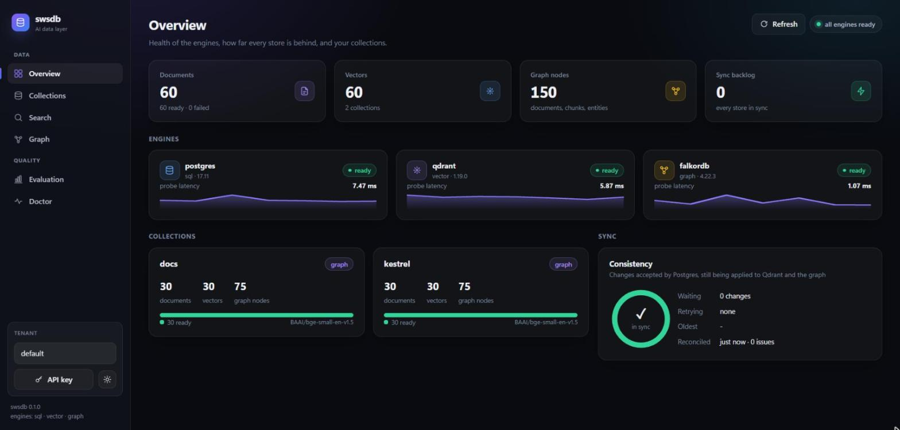
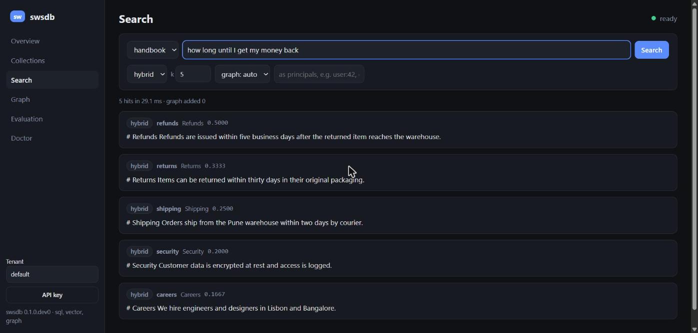
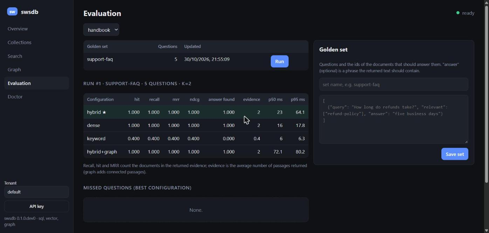
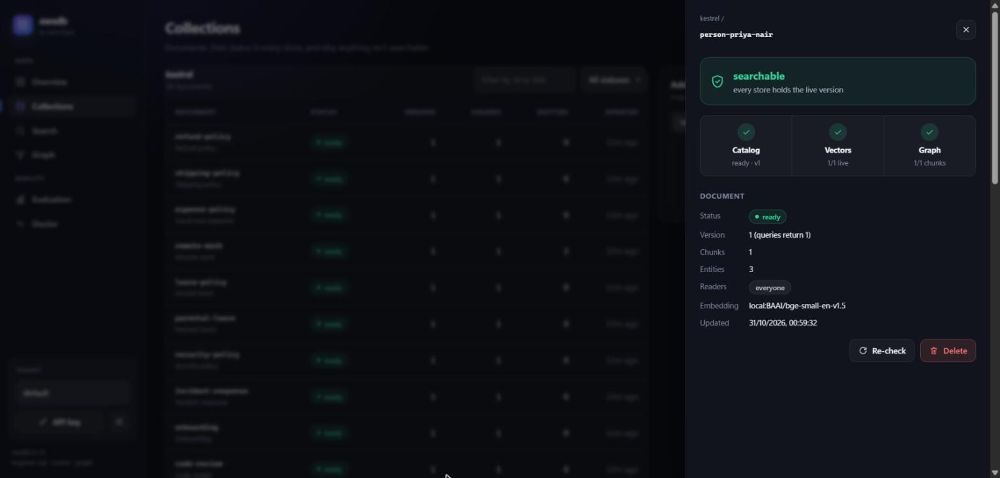

# swsdb

**One database for AI applications: PostgreSQL, Qdrant and FalkorDB in one container, kept consistent, with
permission-aware hybrid and graph retrieval and cited answers.**

```bash
docker run -d --name swsdb -p 6464:6464 -v swsdb-data:/swsdb/data ghcr.io/prosws2210/swsdb:latest
pip install swsdb
swsdb demo        # loads a sample handbook, then answers questions with citations
```

```text
> Which office does the lead of Project Orion work from?
Project Orion is the new search platform, led by Priya Nair. [1] Priya Nair is a principal engineer who works from the Lisbon office. [5]
Sources:
  [1] project-orion (Project Orion)
  [5] person-priya-nair (Priya Nair)
```

Passage 5 never mentions Project Orion: swsdb found it through the knowledge graph, with no API key and no model
configured. From `docker run` to these answers took 19 seconds on a laptop. Open <http://localhost:6464/console> to
see how.

**Docs:** [quickstart](docs/quickstart.md) · [start a new project](docs/guides/projects.md) · [RAG app](docs/quickstarts/rag-app.md) · [GraphRAG](docs/quickstarts/graphrag.md) ·
[agent memory over MCP](docs/quickstarts/agent-memory.md) · [LangChain, LlamaIndex, TypeScript](docs/guides/integrations.md) ·
[deployment (Compose, Helm, managed engines)](docs/guides/deployment.md) · [security](docs/guides/security.md) ·
[backups and upgrades](docs/guides/backups.md) · [webhooks](docs/guides/webhooks.md) · [API](docs/reference/api.md) ·
[benchmarks](docs/benchmarks.md)

## Why

AI applications need three kinds of storage at once: relational for users, permissions and documents, vectors for
semantic search, a graph for entities and how they relate. Running Postgres, Qdrant and a graph database side by side
means writing the glue yourself: shared ids, chunking, embedding, entity extraction, permission filters, and code that
keeps all three in step when a document changes, is deleted, or an engine is down. swsdb is that glue, shipped as a
database server.

## What you get

- **One container instead of three for every project.** Each project gets a Postgres connection string for
  SQLAlchemy, Alembic, Django, Prisma or psql, and the Qdrant API for the standard Qdrant client. Each sees only its own
  schema and collections. See [Start a new project](docs/guides/projects.md).
- **Documents in, cited answers out.** PDF, Markdown, HTML or text are chunked by structure and embedded (dense and
  BM25, with a bundled model that works offline, or any OpenAI-compatible endpoint). The people, projects and products
  they mention are linked in a graph. `answer` replies citing `[n]` passages; with no model configured it answers
  extractively, so it works with no API key at all. Without a model, passages are linked by the names they share.
- **Hybrid and graph retrieval in one call:** meaning and keywords fused, then passages connected through shared
  entities. Each hit says how it was found.
- **Permissions everywhere.** Each document lists its readers. Search, graph expansion, answers and MCP tools apply them
  inside the engine, so denied text never leaves the server.
- **Real tenants.** API keys bound to one tenant. A collection per tenant in every store, and a Postgres role and schema
  per tenant for SQL. Cross-tenant probes on every read path run in CI.
- **Consistent by construction.** Postgres is the source of truth. Qdrant and the graph follow through an outbox, with
  retries and reconciliation. 100 of 100 chaos rounds (engines and the server killed mid-write) ended converged, with
  no deleted document ever returned.
- **Built for agents.** An MCP server (`/mcp` read-only, `/mcp/rw` read-write, or `swsdb mcp` over stdio): search,
  answers, documents and long-term memory, with the key's permissions.
- **One backup.** `swsdb snapshot create` copies every engine at one consistent point. A snapshot restores on another
  machine or a newer version. Scheduled backups go to S3-compatible storage. Upgrades migrate automatically and keep
  a rollback dump.
- **Fits your stack.** Python (sync and async) and TypeScript SDKs, LangChain and LlamaIndex retrievers, signed webhooks
  when documents become searchable, optional cross-encoder re-ranking, and a `swsdb.yaml` config file.
- **Runs your way.** One container by default; or Docker Compose with each engine in its own container, a Helm chart,
  or managed engines (RDS, Qdrant Cloud, FalkorDB Cloud, Neo4j) by URL. `SWSDB_PROFILE=lite` keeps vectors and graphs
  inside Postgres (pgvector, Apache AGE), so Postgres is the only engine. Several servers can share one set of engines
  (`deploy/compose/docker-compose.ha.yml`).
- **Measured.** Golden question sets with recall, MRR and nDCG per configuration; a "why isn't this searchable?"
  diagnosis; Prometheus metrics and OpenTelemetry traces; a web console; a retrieval-quality gate in CI.
- **No lock-in.** The native engines stay reachable (`swsdb-admin credentials`). SQL and Cypher pass through, sandboxed.

## Use it

```python
from swsdb import SwsDB

db = SwsDB("http://localhost:6464", api_key="...", tenant="acme")
kb = db.create_collection("handbook", documents=True)

kb.upload("employee-handbook.pdf", readers=["group:staff"])
kb.add_text("refunds", "# Refunds\n\nRefunds are issued within five business days.", metadata={"team": "support"})
kb.wait_ready("refunds")

r = kb.answer("How long do refunds take?", principals=["user:42", "group:staff"])
print(r["answer"])                                  # "Refunds are issued within five business days. [1]"
for hit in kb.query("refund policy", k=5, graph_hops=1):
    print(hit["score"], hit["via"], hit["document"], hit["page"], hit["text"][:80])
```

```bash
swsdb ingest docs ./my-folder && swsdb ask docs "What is our refund policy?"
claude mcp add --transport http swsdb http://localhost:6464/mcp/rw --header "api-key: $SWSDB_API_KEY"
swsdb snapshot create --output backup.tar
```

| | |
|---|---|
|  |  |
|  |  |

## Numbers

On a laptop (AMD Ryzen 7 7445HS, 12 threads, Docker Desktop with 7.4 GB), all defaults, CPU only. See
[benchmarks](docs/benchmarks.md):

| | |
|---|---|
| Image | 460 MB, models included (embeddings, BM25, re-ranker) · ready in about 10 s from an empty volume |
| Memory | about 600 MB idle with all three engines and the embedding model |
| Search latency (server side, 3,000 passages) | hybrid p50 22 ms · keyword 7 ms · hybrid + graph 34 ms |
| Ingestion | 11 passages/s with the bundled CPU model (an embeddings endpoint is much faster) |
| Retrieval quality (CI gate) | hybrid recall@5 0.99 · multi-hop questions: recall 0.93 without the graph, 1.00 with it |

## Run it your way

```bash
docker run -d -p 6464:6464 -e SWSDB_ENGINES=vector ghcr.io/prosws2210/swsdb         # just vector search
docker run -d -p 6464:6464 -e SWSDB_ENGINES=vector,graph ghcr.io/prosws2210/swsdb   # GraphRAG without SQL
docker run -d -p 6464:6464 -e SWSDB_API_KEY_FILE=/run/secrets/key \
  -e SWSDB_TLS_CERT_FILE=/tls/cert.pem -e SWSDB_TLS_KEY_FILE=/tls/key.pem ...  # keys and HTTPS
```

All settings: [configuration](docs/reference/configuration.md). Build from source with
`docker build -f docker/Dockerfile -t swsdb/swsdb:dev .`.

## How it fits together

```text
              your app · Python SDK · CLI · MCP clients · web console
                                   │ :6464
┌──────────────────────────── swsdb container ─────────────────────────────┐
│ swsdb server: keys & tenants · ingestion · hybrid + graph retrieval ·    │
│               answers · evaluation · snapshots · MCP                      │
│        sync engine: outbox · idempotent retries · reconciliation          │
│   PostgreSQL 17            Qdrant 1.19               FalkorDB 4.22         │
│   source of truth          dense + BM25 vectors      entities, relations   │
│ s6 supervisor: ordered start/stop · health · restarts · one data volume   │
└──────────────────────────────────────────────────────────────────────────┘
```

Design decisions are in [docs/adr](docs/adr); the roadmap is [PLAN.md](PLAN.md).

## Development

```bash
uv run --project server ruff check server/swsdb_server sdk tests benchmarks examples
uv run --project server pytest                                   # unit tests
docker build -f docker/Dockerfile -t swsdb/swsdb:dev .
uv run --project server pytest -m image tests/image             # against real containers
```

## License

swsdb is source-available under the [Functional Source License (FSL-1.1-ALv2)](LICENSE): use it, including at work,
but don't sell it or something substantially similar as a competing product or service. Each version becomes
Apache-2.0 two years after its release. The bundled engines keep their own licenses
(PostgreSQL License, Apache-2.0 for Qdrant, SSPLv1 for FalkorDB); see [PLAN.md](PLAN.md#10-licensing). Report
vulnerabilities privately: [SECURITY.md](SECURITY.md).
